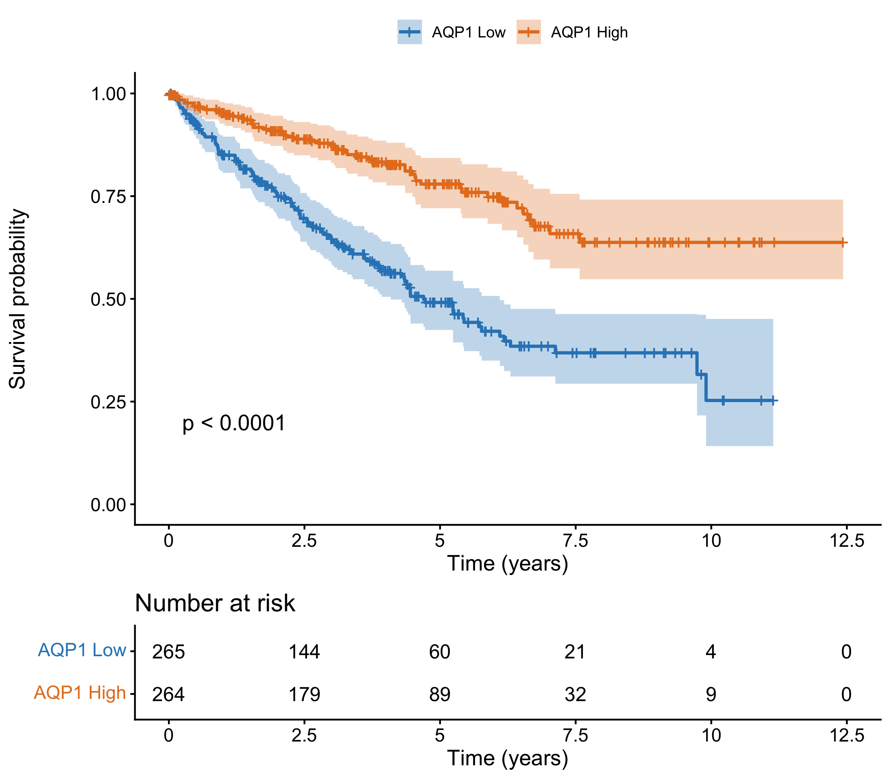
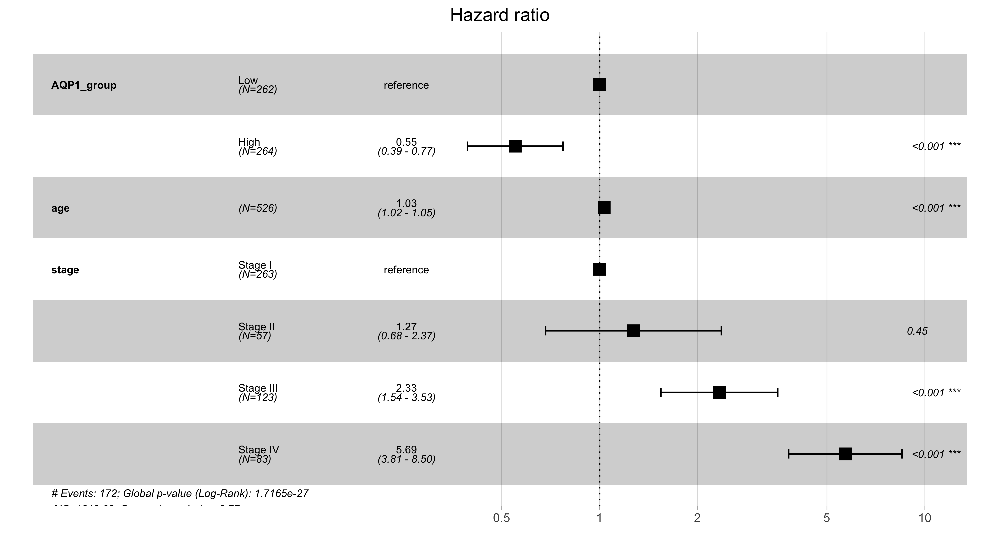
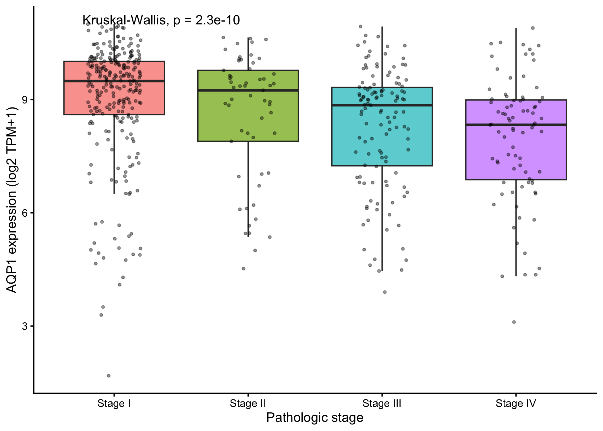

# AQP1 and Survival in Kidney Cancer (TCGA-KIRC)

## Background

AQP1 (aquaporin-1) is a channel protein that transports water and is highly expressed in normal kidney tubules.

In our previous study ([Liu et al., 2025](https://doi.org/10.1186/s40246-025-00726-9)), we measured AQP1 protein by immunohistochemistry in 370 patients with kidney tumors from Xinhua Hospital in Shanghai. We found that AQP1 expression was lower in tumors than in normal tissue，and that high AQP1 expression was an independent protective factor for overall survival.. This project uses the publicly available TCGA-KIRC dataset to validate this finding in an independent cohort of patients with clear cell renal cell carcinoma (ccRCC). Unlike the previous study, which measured protein, this project uses RNA sequencing data, providing a test of whether the result holds across a different population and a different measurement method.

## Data

All data were downloaded from the [UCSC Xena](https://xenabrowser.net/) GDC TCGA-KIRC hub in October 2026:

| File | Content |
|---|---|
| `TCGA-KIRC.star_tpm.tsv.gz` | Gene expression (RNA-seq), log2(TPM+1) |
| `TCGA-KIRC.survival.tsv.gz` | Overall survival time and status |
| `TCGA-KIRC.clinical.tsv.gz` | Clinical information (age, pathologic stage, sex) |

The data files are not included in this repository because of their size. See [How to reproduce](#how-to-reproduce).

### Sample selection

| Step | Samples / patients |
|---|---|
| All samples with expression data | 610 |
| Primary tumor samples only (barcode type `01`) | 537 |
| With survival data | 533 |
| One sample per patient | **529 patients** (173 deaths) |
| With age and stage available (multivariable analysis) | 526 patients |

Four patients had two primary tumor samples (`01A` and `01B`); the `01A` sample was kept. Median follow-up time was 3.3 years.

## Methods

1. **Grouping.** Patients were divided into AQP1-high and AQP1-low groups at the median AQP1 expression (9.04, log2 TPM+1). A median cut-off was chosen in advance, rather than an "optimal" cut-off, to avoid overestimating the effect.
2. **Kaplan-Meier analysis.** Overall survival was compared between the two groups using Kaplan-Meier curves and the log-rank test.
3. **Univariate Cox regression.** The hazard ratio (HR) for AQP1-high vs. AQP1-low was estimated.
4. **Multivariable Cox regression.** AQP1 group, age (continuous), and AJCC pathologic stage (Stage I as reference) were included in the same model to test whether AQP1 is an independent prognostic factor. A sensitivity analysis additionally adjusted for sex.
5. **AQP1 by stage.** AQP1 expression was compared across pathologic stages using the Kruskal-Wallis test.

All analyses were performed in R 4.6.1 with the `tidyverse`, `survival`, and `survminer` packages.

## Results

### 1. High AQP1 expression is associated with longer overall survival



Patients with high AQP1 expression had significantly better overall survival (log-rank p < 0.0001). About 78% of AQP1-high patients were alive at 5 years, compared with about 50% of AQP1-low patients. In the univariate Cox model, high AQP1 expression was associated with a 64% lower risk of death (HR = 0.36, 95% CI 0.26–0.50, p < 0.001).

### 2. AQP1 remains an independent prognostic factor after adjusting for age and stage



After adjusting for age and pathologic stage, high AQP1 expression remained significantly associated with lower risk of death (HR = 0.55, 95% CI 0.39–0.77, p < 0.001). As expected, older age and advanced stage (Stage III: HR = 2.33; Stage IV: HR = 5.69) were associated with higher risk.

### 3. AQP1 expression decreases with advancing stage



Median AQP1 expression decreased from Stage I (9.49) to Stage IV (8.33) (Kruskal-Wallis p = 2.3 × 10⁻¹⁰). This explains why the HR moved closer to 1 after adjusting for stage (from 0.36 to 0.55): patients with low AQP1 were more likely to have advanced disease. However, AQP1 levels overlapped widely between stages, and AQP1 still provided prognostic information beyond stage. This trend is consistent with the clinical cohort in Liu et al. (2025), where lower stage was more common in the AQP1-high group.

## Conclusion

In 529 patients with clear cell renal cell carcinoma from TCGA, high AQP1 mRNA expression was associated with longer overall survival and remained an independent protective factor after adjusting for age and pathologic stage. In a sensitivity analysis that also adjusted for sex, the result was unchanged (HR = 0.51, 95% CI 0.36–0.72, p < 0.001); sex itself was not significantly associated with survival (HR = 0.77, 95% CI 0.55–1.07). These results independently validate, using a different population and measurement method, the findings of Liu et al. (2025).

## Limitations

- **Validation, not discovery.** The association between AQP1 and ccRCC prognosis has been reported before; this project confirms it in an independent dataset.
- **Limited covariates.** Tumor grade was not available in the GDC clinical file (all samples were "Not Reported") and could not be included.
- **Bulk RNA-seq.** AQP1 is also highly expressed in blood vessel endothelial cells and normal kidney tubules, so tumor AQP1 mRNA may partly reflect tumor vascularity or tumor purity rather than cancer cells alone.
- **Overall survival only.** Disease-specific survival and progression-free interval were not analyzed.
- **Model assumptions.** The proportional hazards assumption was not formally tested.
- **Dichotomization.** Splitting AQP1 at the median loses information compared with treating it as a continuous variable.
- **Correlation, not causation.** These data cannot show whether AQP1 itself affects tumor behavior.
- **Cohort.** TCGA patients were mostly diagnosed in the 2000s–early 2010s, before modern immunotherapy; results may not fully apply to patients treated today.

## How to reproduce

1. Download the three files listed in [Data](#data) from the UCSC Xena GDC TCGA-KIRC hub.
2. Place them in the project folder (the same folder as `kirc-prognosis.Rproj`).
3. Open `kirc-prognosis.Rproj` in RStudio.
4. Install the required packages (once):
   ```r
   install.packages(c("tidyverse", "survival", "survminer"))
   ```
5. Open `01_aqp1_survival.R` and click **Source**. The figures will be saved in the `figures/` folder.

## Repository structure

```
kirc-prognosis/
├── 01_aqp1_survival.R      # Full analysis
├── figures/                # Output figures
├── kirc-prognosis.Rproj    # RStudio project file
├── LICENSE
└── README.md
```

## Acknowledgments

- Data: The Cancer Genome Atlas (TCGA) Research Network, accessed via UCSC Xena.

## Reference

Liu Y, Lyu D, Yao Y, Cui J, et al. The comprehensive potential of AQP1 as a tumor biomarker: evidence from kidney neoplasm cohorts, cell experiments and pan-cancer analysis. *Human Genomics*. 2025;19:15. [doi:10.1186/s40246-025-00726-9](https://doi.org/10.1186/s40246-025-00726-9)
